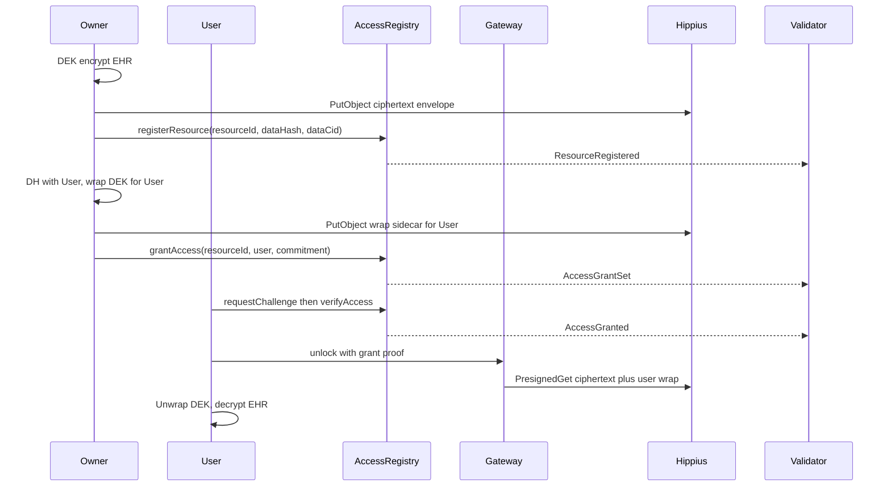

# Hippius as secure EHR storage

Hippius holds **ciphertext only**. Authorization lives on **AccessRegistry** (multi-grantee). MediLink validators poll registry logs — never EHR bytes.

Related:

- [`key-generation/AccessRegistry.sol`](key-generation/AccessRegistry.sol)
- [`key-generation/ehr_hippius.py`](key-generation/ehr_hippius.py)
- [`key-generation/access_registry_client.py`](key-generation/access_registry_client.py)
- [`Contract_Logic.md`](Contract_Logic.md)

---

## Locked design

| Choice | Detail |
|---|---|
| Storage | AES-256-GCM ciphertext before `PutObject` |
| Envelope | One random DEK per record; wrap DEK per grantee |
| KEK | `KEK_u = HKDF(shared_secret_u, info = resourceId \|\| grantee_h160)` |
| Registry | `commitments[resourceId][grantee]`; owner `grantAccess` / `revokeAccess` |
| Gateway | Holds `hip_` S3 keys; PresignedGetObject only after `AccessGranted` for `(resourceId, requester)` |
| Client | Unwraps DEK + decrypts locally |
| Subnet | Receipts from register / AccessGranted logs only |

---

## Object layout (per health record)

```
ehr/{tenant}/{patient_id}/{record_id}/v{n}/payload.bin
ehr/{tenant}/{patient_id}/{record_id}/v{n}/wraps/{grantee_h160}.bin
```

- **`dataCid`** on registry = payload object key (stable record pointer).
- **`dataHash`** = `keccak256(payload_ciphertext_bytes)`.
- One `resourceId` = one health record (stable Hippius object). Many grantees each get their own commitment + wrap sidecar.

### Payload envelope (JSON or CBOR-equivalent fields)

| Field | Meaning |
|---|---|
| `alg` | e.g. `AES-256-GCM` |
| `nonce` | GCM nonce (hex) |
| `ciphertext` | encrypted EHR bytes (hex) |
| `resource_id` | bytes32 hex |
| `aad` | same as `resource_id` (bound in GCM) |

No global `wrapped_dek` inside the payload — wraps are per-user sidecars.

### Wrap sidecar

| Field | Meaning |
|---|---|
| `wrapped_dek` | DEK encrypted under `KEK_u` (AES-GCM) |
| `wrap_nonce` | wrap nonce |
| `grantee` | H160 checksum |
| `resource_id` | bytes32 hex |

### Revoke / new grantee

- **Revoke:** `revokeAccess` on-chain + delete/overwrite that user’s wrap object (ciphertext unchanged).
- **New grantee:** DH → wrap DEK → put wrap sidecar → `grantAccess` (no re-encrypt of large EHR).

Hippius: path-style boto3, `hip_` keys on gateway only, versioning on; Object Lock later (out of scope for legal review).

---

## Store / unlock / monitor



### Unlock steps

1. Owner registers resource + uploads ciphertext once.
2. Per user: DH → wrap DEK → upload wrap → `grantAccess`.
3. User `requestChallenge` / `verifyAccess` → `AccessGranted`.
4. Gateway checks grant for `(resourceId, requester)` → presign **payload + that user’s wrap** only.
5. User unwraps with `KEK_u` → decrypts.
6. Validator receipts `AccessGranted` as AUDIT (and `ResourceRegistered` as WRITE/UPDATE).

---

## Ways to store records

| Pattern | Use |
|---|---|
| **A. Payload + per-user wraps** (default) | Multi-reader EHR without re-encrypt |
| **B. Multipart payload** | Large files; same wrap model |
| **C. Versioned `v{n}`** | Amendments; new payload + re-wrap active grantees (or wrap-only if DEK unchanged and policy allows) |
| **E. Object Lock** | WORM on payload versions (later) |

---

## Multi-user wraps

- One DEK encrypts the EHR once.
- Each authorized user gets `wraps/{lowercase_h160}.bin` under `KEK_u`.
- Challenge/verify uses **that user’s** on-chain commitment (`commitments[id][msg.sender]`).
- Gateway must never presign another user’s wrap path.

---

## Threat / monitoring summary

| Property | Mechanism |
|---|---|
| **Confidentiality** | Hippius leak without wraps/KEK ≠ plaintext; revoke deletes wrap + clears commitment |
| **Authorization** | Per-user on-chain commitment + gateway gate on `AccessGranted` |
| **Integrity / audit** | `dataHash` + subnet receipts; `AccessGrantSet` / `AccessRevoked` available for richer audit later |
| **Subnet** | Monitors authorization/register logs — not EHR bytes |

### Validator event policy

| Event | Default receipt |
|---|---|
| `ResourceRegistered` | WRITE / UPDATE |
| `AccessGranted` | AUDIT (primary unlock signal) |
| `AccessGrantSet` | **skip** (noise; optional AUDIT knob later) |
| `AccessRevoked` | skip or AUDIT |
| `AccessDenied` | skip |
| `ChallengeIssued` | never |

---

## Demo

```bash
# Hardhat node running; redeploy multi-grantee registry
export RPC_URL=http://127.0.0.1:8545 CHAIN_ID=31337
export OWNER_PRIVATE_KEY=0xac0974bec39a17e36ba4a6b4d238ff944bacb478cbed5efcae784d7bf4f2ff80
# Account #1 private key from your `npx hardhat node` banner (version-specific)
export USER_PRIVATE_KEY=0x59c6995e998f97a5a0044966f0945389dc9e86dae88c7a8412f4603b6b78690d
python key-generation/deploy_access_registry.py
# export CONTRACT_ADDRESS from deployment.json output

python key-generation/ehr_hippius.py demo
```

Without `HIPPIUS_*` credentials, the demo uses a local filesystem backend under `key-generation/.ehr_local/`.
