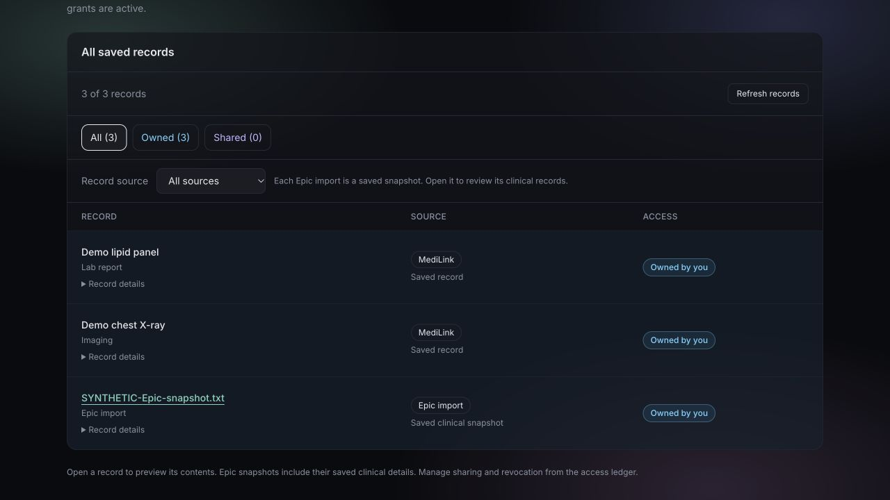
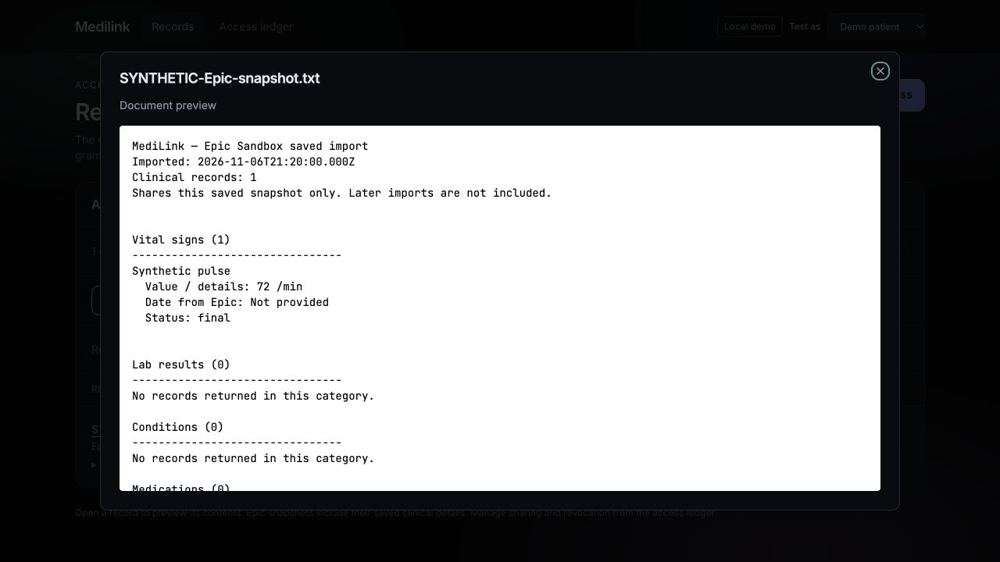
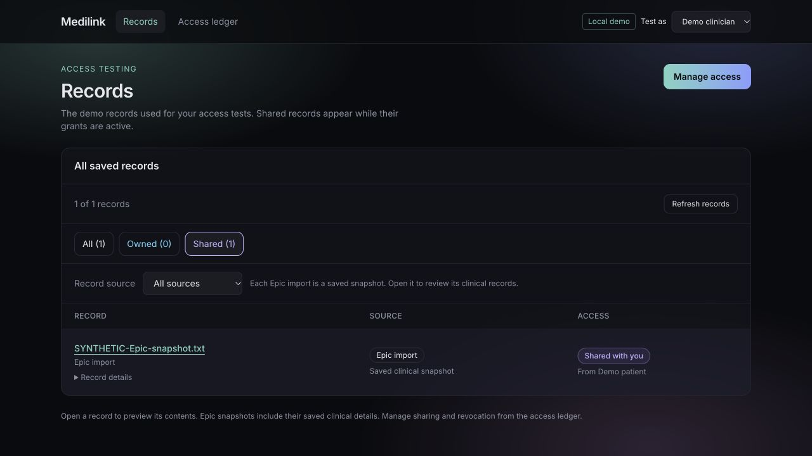

# MAIN-266 — Unify Epic and MediLink Records in One Frontend View

Completed November 10, 2026, in the Fall26 clone on `pre-prod`.

## Result

Records now has one **All saved records** list containing owned MediLink uploads,
saved Epic snapshots (encrypted and legacy), and authorized incoming records.
Removed the separate Epic clinical dashboard panel and its unused component.
Each saved Epic import appears once as a snapshot; its clinical details remain
available by opening the existing readable preview. Individual clinical entries
are not duplicated into the list or independently granted. Existing immutable
snapshot sharing and server access checks are unchanged.

Added source badges and an All sources / Epic imports / MediLink records dropdown.
Source and All / Owned / Shared filters combine. Record IDs and saved timestamps
are available in expandable Record details. Upload document, Import from Epic
(real-account owner view), Manage access, refresh, tags, and existing preview
behavior remain available. Provider-specific routes continue to show authorized
incoming records only. The source filter does not fetch or decrypt the chart;
record previews remain authenticated and are opened on demand.

## Verification

From `frontend`:

```sh
npm test
npx tsc --noEmit
npx eslint src/components/Vault.tsx src/lib/record-source.ts src/lib/record-source.test.ts
npm run build
```

All **26 frontend tests pass**. TypeScript, changed-file lint and production build
pass. Added source classification tests for encrypted UUID snapshots, legacy
imports, ordinary documents, and wallet discoveries. No backend changes.

Browser verification used a separate loopback API and frontend in fixture mode,
with synthetic data only; real accounts and stored patient records were untouched.

- One list showed two MediLink fixture rows and one synthetic Epic snapshot.
- Epic source filter showed one row; MediLink source filter showed two rows.
- Opening Epic displayed readable synthetic clinical details (pulse 72 /min).
- A synthetic grant appeared in the recipient's same list, labeled Epic import
  and Shared with you; its preview opened successfully.
- After fixture grant revocation and refresh, the recipient list was empty.

This validates the frontend integration, not a new live Epic OAuth/import run,
cloud storage operation, or real-chain transaction.

## Sprint-report wording

Replaced separate Epic and MediLink panels with one saved-records list. Added
source labels and filtering while retaining record previews, ownership filters,
upload/import entry points, and access management. Browser-tested mixed sources,
Epic clinical previews, recipient delivery, and removal after revocation. All 26
frontend tests, TypeScript, lint, and the production build passed.




