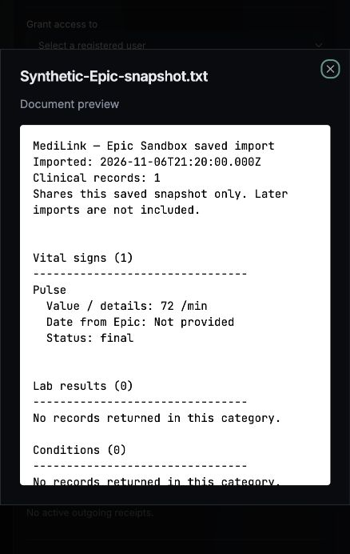
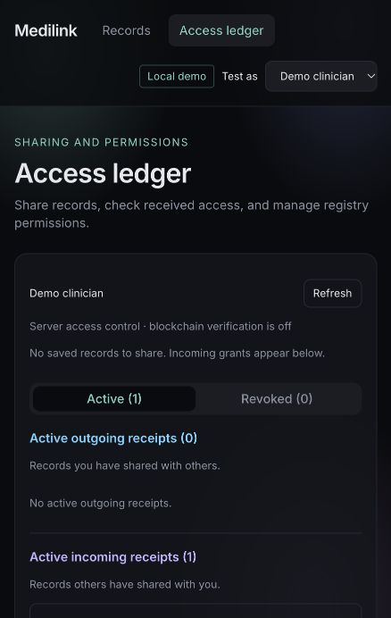
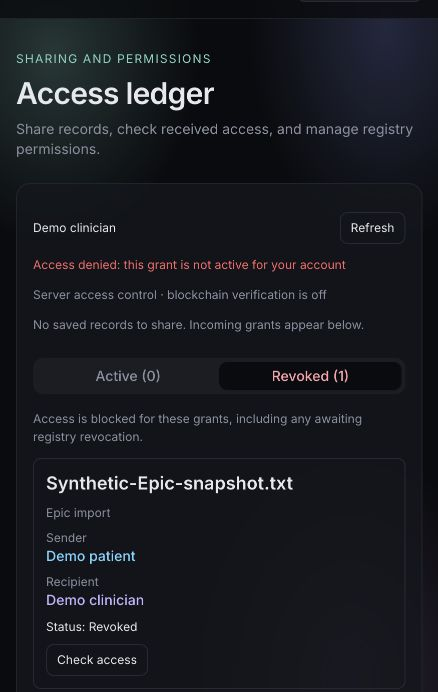

# Epic import-to-sharing sprint — MAIN-267, MAIN-268, MAIN-239

## Branch and integration

Work is on `codex/main-267-268-239-import-sharing` in both Main-Project and its
`frontend` submodule (health-locker-guard). Parent base: `origin/pre-prod` at
`f9d7db3`; frontend base: the parent-pinned `acc9610`. Frontend `origin/pre-prod`
is an ancestor of that pinned commit. `main` in the parent still contains the older
Bittensor prototype, so the feature needs the existing pre-prod app as its base.
No main or shared pre-prod branch is changed by this sprint.

Publishing status: local feature commits only. Remote push awaits explicit user
approval. Push the frontend feature branch first, then the matching parent branch;
the parent gitlink currently references the local frontend feature commit.

Before merging later this week, review the feature against **pre-prod** to see only
this sprint's changes. Comparing the parent to main also includes all existing
pre-prod development. Integrate that app history deliberately with the team.
The frontend is a separate repository: merge/publish its changes first, then update
and merge the parent gitlink. Keep the feature commit reachable remotely so the
parent's submodule reference can be cloned. Do not squash or rewrite published
history on the Lovable-connected branch.

## Delivered work and sprint-report wording

| Item | How was it tested/documented? | Scope of completion |
| --- | --- | --- |
| MAIN-267 — Validate Record Sharing Across Two MediLink Accounts | Tested two independent synthetic vault identities using the actual browser encryption code and a shared signed ciphertext fixture. API regression verifies owner-only import handoff, recipient key delivery, exact snapshot bytes, outsider denial, restart, owner-only revoke, and denial of both key and file delivery after revocation. Registry simulation additionally checks incoming/outgoing receipts, live permission checks, RPC outage denial and wallet revocation. Existing tests cover two-way legacy sharing and chart isolation. | Automated validation complete; live Supabase/Epic accounts and real chain transactions still require the manual acceptance below. |
| MAIN-268 — Improve the Imported Record Sharing Experience | Added individual record checkboxes, selected-record count and a disabled Grant action until records and recipient are chosen. Category changes clear selection. Added a Share a saved import link, readable decrypted snapshot previews, and corrected guidance for encrypted versus legacy imports. Verified selection, preview, recipient open and revoked access in the local browser demo. | Implemented and locally verified. |
| MAIN-239 — Document and Demonstrate the Complete Import-to-Sharing Workflow | This guide contains setup, repeatable verification commands, a two-account demo script, acceptance checklist, limitations and synthetic browser evidence. | Documentation and local sharing demonstration complete; live Epic authorization/import demo pending. |

Do not describe synthetic identities as real account logins or report a live Epic
transfer, real Hippius upload or mined transaction based on these tests. Do not
substitute test runtime for the sprint's actual labor hours.

## Verification

From `backend/key-generation`, with requirements installed in a Python virtualenv:

```sh
python -m pytest tests -q
```

Result: **128 passed, 4 skipped**. The four opt-in blockchain integration checks
require a separate running node. The new encrypted fixture crosses the JS/Python
boundary: frontend tests decrypt it, backend tests validate its signature, store
and authorize the identical ciphertext and recipient envelope. Epic, Supabase,
Hippius and registry responses are simulated. Existing websocket dependency emits
a deprecation warning.

From `frontend`:

```sh
npm ci --ignore-scripts
npm test
npx tsc --noEmit
npx eslint src/components/AccessPanel.tsx src/components/DocumentDialogs.tsx src/components/EpicRecords.tsx src/lib/epic-preview.ts src/lib/epic-preview.test.ts src/lib/epic-sharing.test.ts
npm run build
```

Result: **23 tests passed**; TypeScript, changed-file lint and production build
passed. The lockfile installation reports 20 dependency audit findings; upgrading
the dependency tree is outside this sprint. Dependencies and lockfiles were not
changed.

To deliberately regenerate the public synthetic encrypted fixture, from `frontend`:

```sh
EPIC_SHARING_FIXTURE=src/lib/fixtures/epic-shared-document.json npm test -- src/lib/epic-sharing.test.ts
cp src/lib/fixtures/epic-shared-document.json ../backend/key-generation/tests/fixtures/epic_shared_document.json
```

The deterministic private keys in that test are public test-only values. The
identical fixture copies let each repository test independently. The fixture contains invented Pulse data and no credentials or real patient data.

## Live two-account demonstration / final acceptance

Use two browser profiles and two disposable MediLink test accounts: A (patient,
import owner) and B (recipient). Optionally use C as an unrelated account. Use
Epic Sandbox data only. Follow [LOCAL_TESTING.md](../../LOCAL_TESTING.md) for
matching Supabase authentication, API, blockchain, faucet, and frontend setup.
Follow [EPIC_IMPORT.md](../../backend/EPIC_IMPORT.md) for Epic OAuth configuration.
New encrypted imports require configured Hippius document storage and its database
migrations. Both accounts must unlock and enroll their vaults. Fixture demo mode
cannot authorize a live Epic import. Never put server credentials in `VITE_*`.

1. Sign in as B, unlock its vault, and open **Access ledger** to enroll. Record B's
   displayed encryption fingerprint through a trusted channel. Do the same for A.
2. As A, open **Import from Epic**, authorize an Epic Sandbox patient, and finish
   the import. Wait for browser encryption/publication to complete. On Records,
   verify the expected imported count/categories and a known synthetic value.
3. Click **Share a saved import**. Select B and the **Epic import** record type.
   Check exactly one named snapshot. Confirm the count says one, and use
   **Review content before sharing** to verify the imported value and timestamp.
   No grant is submitted by previewing content.
4. Click **Grant 1 selected record(s)**. Verify the fingerprint prompt against B.
   With a configured registry, the unlocked owner vault signs resource/grant
   transactions. Wait until the outgoing receipt is active. Save the receipt ID,
   snapshot ID and transaction hash when present; omit secrets from evidence.
5. As B, refresh **Access ledger** and open the incoming receipt. Verify A is the
   sender, the snapshot name matches and **Open shared content** shows the same
   clinical value. Confirm B's own imported chart did not acquire A's records.
6. As C, verify no incoming receipt appears and authenticated direct requests to
   the record's `/encryption` and `/document` endpoints are denied. Also confirm B
   cannot re-share A's record or revoke A's grant.
7. As A, create a second import. Confirm B's existing grant still opens the first
   snapshot; the new snapshot requires separate selection and a new grant.
8. As A, revoke the original receipt. As B, refresh: the receipt moves to Revoked,
   **Open shared content** disappears and **Check access** denies access. Direct
   `/encryption` and `/document` requests must also fail. A can still open its copy.
9. Repeat after an API restart and test a separate grant in the reverse direction
   if both accounts are patients with their own imports. Revoking one grant must
   leave the independent grant working.

Live acceptance record (fill after executing; deliberately not pre-checked):

- [ ] A/B sign-in, vault enrollment and fingerprint verification
- [ ] Live sandbox authorization, browser encryption and successful publication
- [ ] B opens exact shared snapshot; C denied; charts remain isolated
- [ ] New import does not expand original grant
- [ ] Revoke blocks future key/file requests; owner retains access
- [ ] Receipt/transaction evidence captured without credentials or patient details

Revocation blocks future API access. It cannot erase a downloaded copy, an already
open preview or a key/ciphertext the recipient already retained.

## Local browser demonstration evidence

The browser check used a temporary API/database on loopback, fixture patient and
clinician identities, and an invented snapshot. The snapshot was uploaded locally
to exercise selection and rendering; it did not pass through live Epic OAuth or
browser vault encryption. The separate crypto/API tests above cover encryption.
The owner selected one record, created one grant, the clinician opened it, and
then the owner revoked it. The clinician's subsequent Check access was denied.






## Follow-up: local encrypted storage for real-account testing

Added an explicit `DOCUMENT_STORAGE_BACKEND=local` option so the full browser
import, encrypted publication, grant, recipient-open and revoke workflow can be
tested without Hippius credentials. Authentication stays with Supabase; local
storage uses durable ciphertext and signed recipient envelopes, with the same
API permission checks. The frontend now respects the API's chain-enabled state
when choosing wallet sharing and discovering wallet receipts.

See [Local testing](../../LOCAL_TESTING.md#local-encrypted-document-storage-no-hippius-account-required).
This removes the cloud-storage prerequisite for local wiring validation; it does
not validate actual Hippius connectivity or blockchain transactions. The earlier
live acceptance checklist remains pending until executed with the two accounts.

Local-storage follow-up verification: **132 backend tests passed, 4 opt-in chain tests skipped; 23 frontend tests passed.** TypeScript, changed-file lint, and production build passed. The running real-account API health reports local storage enabled and blockchain disabled; the provider access ledger shows the local encrypted-storage notice. No real-account record has been granted during this follow-up.
