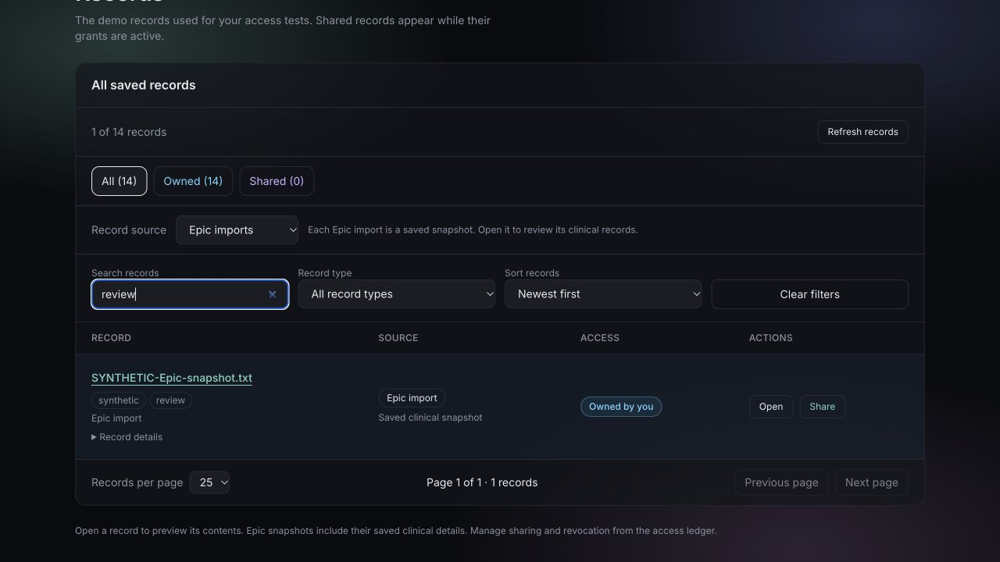
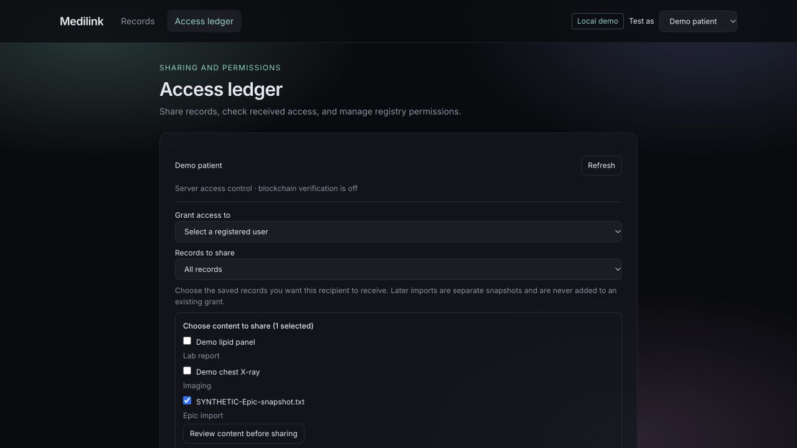
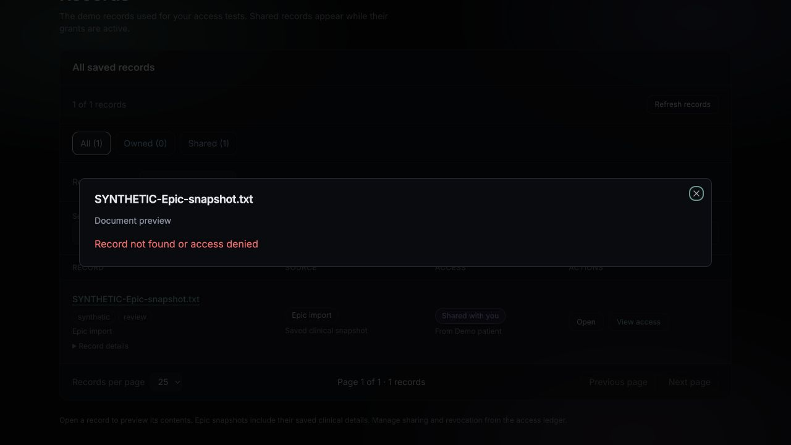

# MAIN-267 — Preserve Record Actions and Filtering in the Unified View

Implemented November 10, 2026 on `pre-prod` in the Fall26 clone. This is the new
unified-view follow-up task; earlier two-account validation remains documented
in MAIN-267-268-239.md.

## Behavior

- Retained source and All / Owned / Shared filters, upload/import entry points,
  preview, tags, record details, access badges, and the central access ledger.
- Added case-insensitive multi-word search across name, ID, type, tags and sender.
  Search operates on authorized record metadata; it never fetches/decrypts document
  contents just to match a query.
- Added record-type filtering, newest/oldest/name sorting, Clear filters, and
  10/25/50-row pagination. Undated records sort last in both date modes. Sorting
  does not mutate the fetched array. Filter/sort/page-size changes reset the page;
  refresh retains filter selections. If records disappear, the page clamps to the
  valid result range rather than showing an empty out-of-range page.
- Each previewable record has an explicit Open button. Owned rows have Share,
  which navigates to the access ledger with that exact record checked. It does
  not submit a grant or select a recipient. Only records returned as owned are
  kept in that selection; incoming/unavailable IDs produce an explanatory notice.
- Incoming rows offer View access instead of Share. Recipients still cannot
  grant another account's record. Revocation remains in the access ledger and
  every new preview still requires server authorization.

## Verification

From `frontend`:

```sh
npm test
npx tsc --noEmit
npx eslint src/components/Vault.tsx src/components/AccessPanel.tsx src/routes/access.tsx src/lib/record-filters.ts src/lib/record-filters.test.ts
npm run build
```

**31 tests pass**, including five new regressions covering combined filters,
case-insensitive metadata search, missing dates, sorting without mutation,
pagination boundaries and page clamping after removal. TypeScript, changed-file
lint and production build pass. No backend or storage changes.

Browser tests used an isolated fixture-mode API/frontend, fourteen synthetic
records, and demo patient/clinician accounts; existing real accounts/data were
untouched. Verified:

1. Ten-row paging shows a second page with exactly four remaining records.
2. Source + type + tag search + sort combine and reset to page one; refresh keeps
   the current query, source, type and sort. Clear filters restores the list.
3. Explicit Open displays Epic clinical details and an ordinary MediLink document.
4. Share on a particular Epic row preselects only that record. No grant exists
   until the tester selects a recipient and clicks Grant.
5. That grant appears in the clinician's unified list with Open and View access,
   without a Share action. The same incoming ID in a sharing shortcut is rejected
   for selection because it is not owned by the clinician.
6. Searching the incoming record by sender and tag works. Its Open action shows
   the preview. Revoking as the fixture owner makes the stale row's next Open fail
   with access denied. Refresh removes the row while preserving the search text.

This is frontend integration validation using synthetic data, not a new live
Epic import, real-chain transaction or Hippius connectivity test. The prior
real-account sharing/revocation evidence is unchanged.

## Sprint-report wording

Preserved record previews and access management in the unified view. Added
combined metadata search, source/ownership/type filters, sorting, pagination,
and record-specific Open/Share actions. Verified owner-only share preselection,
recipient viewing, filter persistence, and denial/removal after revocation.
All 31 frontend tests, TypeScript, lint, and the production build passed.




