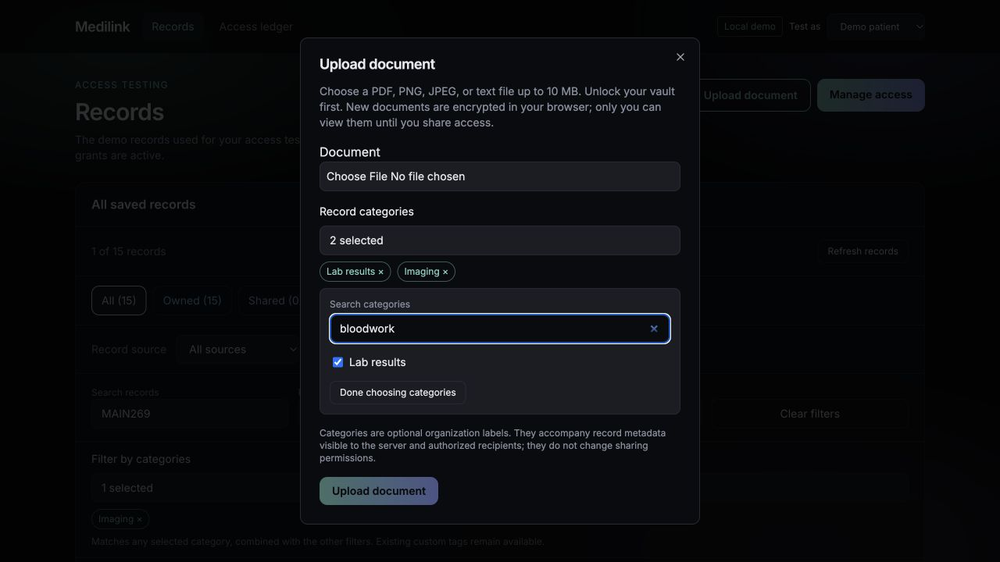
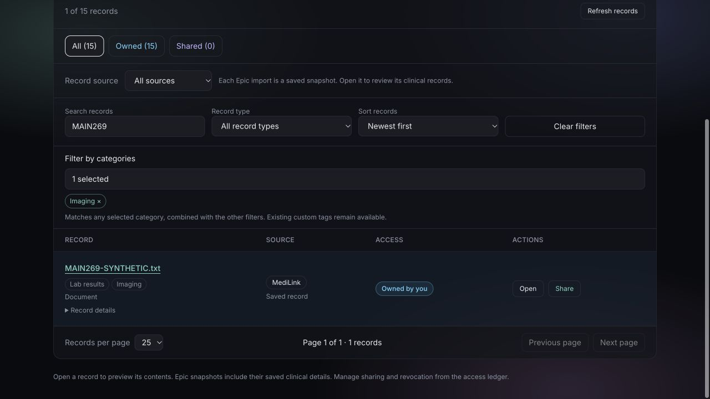

# MAIN-269 — Implement a Searchable Record Tag Dropdown

Implemented November 11, 2026, in the Fall26 clone on `pre-prod`.

## Delivered

- Replaced free-text tags on upload with an optional searchable multi-select
  Record categories dropdown using the thirteen accepted research categories.
- Searches friendly names and aliases: bloodwork/labs find Lab results,
  radiology finds Imaging, prescriptions finds Medications, and vaccinations
  finds Immunizations. New selections save canonical display strings through
  the existing API. No database migration or clinical-code assignment.
- Added selected chips with remove controls, checkbox keyboard interaction,
  no-match feedback, and a 20-selection cap. Existing server limits are checked
  before upload: 20 tags, 50 characters per tag, 1,000 serialized characters.
- Added the same picker to unified-record filtering, including available custom
  legacy tags. Selected categories match with OR; other source, ownership, type
  and search constraints combine with AND. Filter changes reset paging; Clear
  filters clears categories; refresh keeps selections.
- Whole legacy aliases match canonical category filters without rewriting their
  stored strings. Unknown existing labels remain visible/searchable/selectable.
  New custom-tag creation and metadata editing are not added by this task.
- Category state remains separate from `kind`, Epic source classification,
  immutable document bytes, and permissions. No category is required. Imported
  snapshot tags are retained; no speculative automatic clinical categorization.
- Added visibility guidance explaining that categories accompany readable
  metadata and do not change access. They are not private notes or security labels.

## Keyboard and layout

The trigger supports Enter/Space and ArrowDown to open. Opening focuses search;
Tab reaches checkboxes, Space toggles them, and Escape closes the picker and
returns focus to its trigger. Inside the upload dialog, Escape first closes
only the dropdown, retaining the form/file selection. Done closes the dropdown.
The upload dialog has a viewport height limit and scrolls when expanded.

Browser testing caught the original Escape-to-modal-dismiss interaction; it was
fixed and rechecked before publishing. Selected chips remain removable even when
a search hides their corresponding option.

## Verification

From `frontend`:

```sh
npm test
npx tsc --noEmit
npx eslint src/components/RecordTagPicker.tsx src/components/DocumentDialogs.tsx src/components/Vault.tsx src/lib/record-tags.ts src/lib/record-tags.test.ts src/lib/record-filters.ts
npm run build
```

**36 frontend tests pass**; TypeScript, changed-file lint and production build
pass. Added tests for catalog uniqueness, alias/case matching, unknown legacy
preservation, exact OR matching, empty selection, serialization limits, combined
filters, and avoiding mutation of existing tags.

From `backend/key-generation`:

```sh
python -m pytest tests/test_epic_client_storage.py -q
```

**2 parameterized integration tests pass**, using actual encrypted fixtures with
local and simulated Hippius storage. New assertions confirm Lab results/Imaging
metadata survives publication, recipient grant delivery and API restart. Existing
ciphertext, ownership and revocation checks remain in that test. This is not a
live cloud connectivity test.

Synthetic browser checks used a separate fixture-mode API/frontend:

- Alias search, multi-select, chip removal and no-match feedback worked.
- A legacy `labs` tag matched the Lab results filter without changing its value.
  Custom `visit` was selectable; source and category constraints combined.
- Uploaded `MAIN269-SYNTHETIC.txt` through the browser with Lab results and Imaging;
  both strings appeared in the saved record and remained after refresh.
- A fixture recipient received the same tags, filtered by Imaging via radiology
  search, and opened the authorized synthetic document.
- Rechecked Escape leaves the upload dialog open and focuses the closed trigger.
- Confirmed the expanded picker fits within the upload dialog viewport.

The synthetic demo uses plaintext fixture uploads; separate encrypted-storage
integration tests verify the ciphertext path. Existing real accounts, passwords,
patient records and vault data were not changed. No live Epic import or Hippius
operation is claimed.

## Sprint-report wording

Implemented the researched thirteen-category searchable multi-select dropdown
with aliases, removable chips, keyboard controls and optional selection. Added
category filtering while preserving legacy tags and the existing API contract.
Verified upload/refresh, recipient metadata and preview, combined filters and
server limits. All 36 frontend tests, two encrypted-storage integration cases,
TypeScript, lint and the production build passed.



