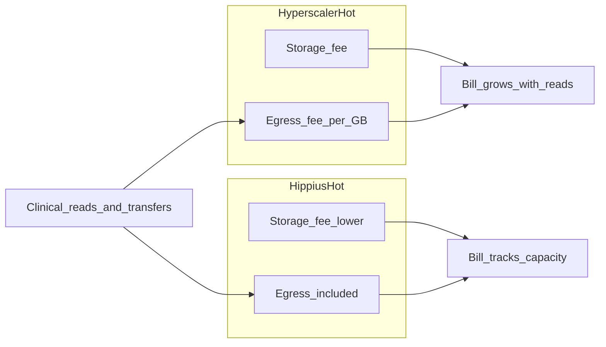
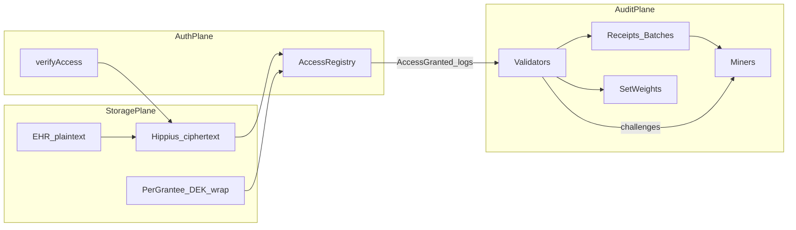
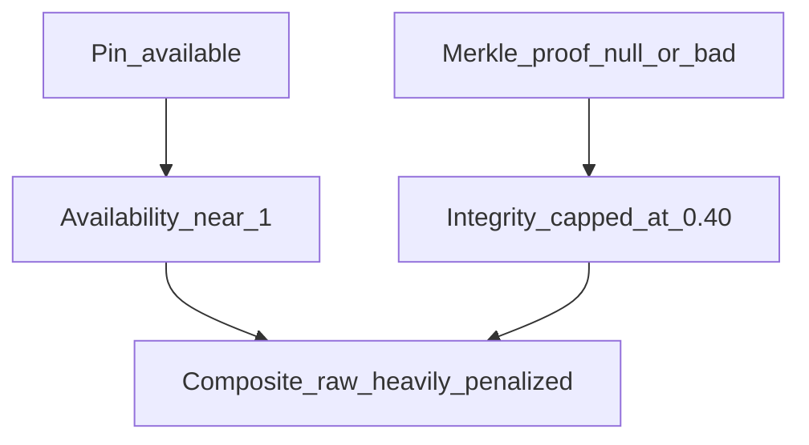
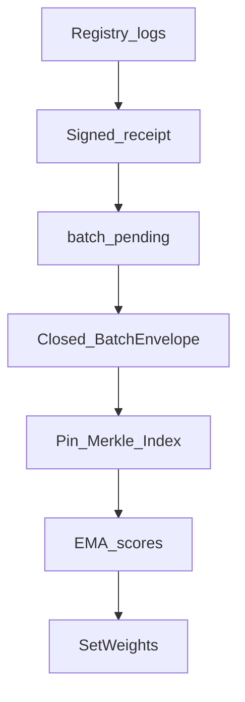
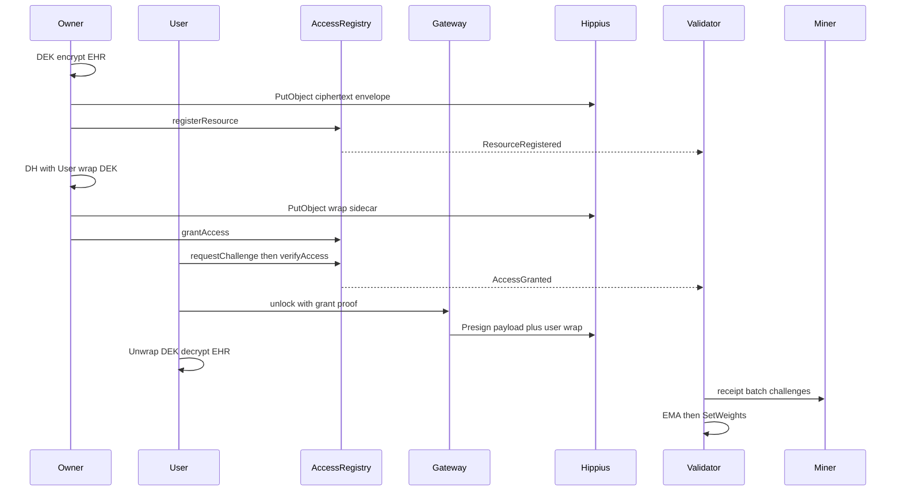

# MediLink: A Peer-to-Peer Healthcare Integrity Market

*Authors: MediLink contributors*  
*Status: Draft v0.2 — aligned to the implemented Main-Project stack*

---

## 00 / Abstract

Centralized electronic health record (EHR) providers have become the default infrastructure of modern care — and they are failing patients on the dimensions that matter most. Clinical data remains trapped in institutional silos: even after U.S. interoperability rules mandating FHIR APIs and prohibiting information blocking, a person’s history is still fragmented across hospitals, clinics, payers, and clearinghouses, with no unified place the individual controls. Consent often fails to travel with the data. Patients have minimal real control over who unlocks their charts; HIPAA’s accounting-of-disclosures right excludes most routine treatment, payment, and operations access, so a complete “who viewed my record” log is rarely available as a patient-facing right. Switching vendors is costly and disruptive, reinforcing lock-in.

Concentration of PHI in large intermediaries has also produced catastrophic breach surface area. The February 2024 Change Healthcare ransomware attack ultimately affected on the order of **~192.7 million** individuals according to HHS/OCR updates; UnitedHealth reported losses measured in the **billions**. Ascension’s May 2024 ransomware disrupted EHR and clinical systems across roughly **140** hospitals and impacted on the order of **~5.6 million** people. In 2024, ransomware accounted for a large majority of individuals affected by large PHI breaches. When a single clearinghouse or health system is compromised, national claims processing and bedside care can halt for weeks — a structural risk of centralization, not a one-off IT failure.

Finally, even when institutions host records on hyperscale cloud object storage, economics punish the access patterns healthcare actually needs. “Hot” clinical data must be readable without multi-hour restores, yet hyperscalers charge separately for storage **and** for egress: on the order of **~$0.02/GB-month** for standard/hot tiers and **~$0.09–$0.12/GB** for internet egress after small free allowances (AWS S3, Azure Blob Hot, GCP Standard — list rates vary by region). Frequent second opinions, care transitions, imaging pulls, and patient downloads turn bandwidth into the dominant bill. Cold or archive tiers only appear cheaper until retrieval and delay costs are counted.

**MediLink** is our solution to this stack of failures. We separate (1) **encrypted** EHR bytes on decentralized Hippius (Bittensor SN75) object storage — S3-compatible, always treated as **hot** storage, with published list pricing from about **$0.0045–$0.0060/GB-month** and **egress included at $0** — from (2) **owner-controlled** authorization on AccessRegistry (per-grantee cryptographic commitments, grant/revoke, challenge–response unlock), from (3) a **Bittensor audit subnet** that never holds PHI but continuously prices integrity of write-and-access receipts via Merkle challenges and on-chain weights. Individuals and institutions regain control over who may unlock ciphertext; successful unlocks become durable AUDIT receipts the owner can inspect; and storing plus frequently reading clinical objects no longer incurs a hyperscaler egress tax. The remainder of this paper specifies the three-plane model, incentives, protocol, threats, and cost comparison in detail.

---

## 0.1 / Introduction

### Failures of centralized health-record infrastructure

Modern care delivery has come to rely almost entirely on a small set of EHR vendors, health systems, and clearinghouses. Four structural failures follow.

**Silos and weak individual agency.** Records are owned operationally by the institution that created them. A patient who sees a primary care clinic, a hospital ED, and a specialist often cannot assemble a single portable history without portal hopping, PDFs, or fax. The 21st Century Cures Act / ONC Cures Act Final Rule pushed certified health IT toward standardized FHIR R4 APIs and banned information blocking so electronic health information can be accessed “without special effort,” yet fragmentation persists across implementations, and consent frameworks frequently do not travel with data across organizational boundaries. Interoperability between *institutions* is not the same as **personal control** by the data subject.

**Opaque access and thin audit rights.** HIPAA requires covered entities to provide an accounting of certain disclosures, but **excludes** most disclosures for treatment, payment, and health-care operations — precisely the accesses patients care about when asking “who opened my chart?” Proposals for richer patient-facing EHR access reports under HITECH were not finalized as a general patient right. In practice, individuals depend on vendor portals and institutional goodwill rather than a machine-verifiable, owner-inspectable unlock log.

**Catastrophic concentration risk.** Centralized PHI honeypots invite ransomware and nation-scale outages. Change Healthcare (2024) and Ascension (2024) illustrate the pattern: encrypt-or-exfiltrate attacks against intermediaries and health systems, multi-million-person breach notifications, and weeks of degraded care and claims. Industry analyses of 2024 large breaches show ransomware driving the bulk of affected individuals. No amount of perimeter tooling removes the single-operator trust assumption when both bytes and access logs live inside one administrative domain.

**Vendor lock-in and cost of exit.** ONC and industry guidance document that switching EHRs is expensive and operationally risky; incomplete migration and months of parallel systems are common. Dissatisfied organizations often stay put. Lock-in is not only clinical UX — it is also where data lives, how APIs are gated, and whether an independent auditor can verify retention of access history.

**Hyperscaler economics that tax mobility.** When PHI or its encrypted form sits on AWS, Azure, or GCP “hot” object storage, list prices for capacity are only part of the story. Ingress is often free or cheap; **egress** — moving data out to clinicians, patients, other clouds, or analytics — is metered at roughly **nine to twelve cents per gigabyte** after small monthly free tiers. Healthcare workloads are read-heavy and multi-party: every care transition is a potential egress event. Archive tiers trade dollars for latency and retrieval fees, which is a poor fit for emergency and ambulatory access.

### MediLink as the response

MediLink reframes the product around three separable planes so that no single vendor simultaneously holds plaintext, authorization, and the sole copy of the audit trail:

1. **Confidential storage** — AES-256-GCM ciphertext and per-grantee DEK wraps on Hippius; leak of objects without wraps/`KEK_u` ≠ plaintext.
2. **Personal authorization** — owner-only `grantAccess` / `revokeAccess` on AccessRegistry; unlock requires proving knowledge bound to an off-chain shared secret; gateway Presign is fail-closed on `AccessGranted`.
3. **Public integrity market** — validators emit signed WRITE/UPDATE/AUDIT receipts from registry events; miners pin them; Merkle and pin challenges price honesty; PHI never enters the subnet wire format.

By measuring “good healthcare storage” as **provable retention of an access-and-write audit chain** plus **owner-gated ciphertext**, MediLink attacks silos (portable `dataCid` + ACL), breach blast radius (ciphertext-only substrate; revoke wraps), patient blindness (AUDIT receipts), and cloud egress taxes (Hippius hot storage with included egress — §0.2). The sections that follow formalize the model, incentives, protocol, and threats.

---

## 0.2 / Economics of Hot Storage

Healthcare objects must behave as **hot storage**: low-latency GetObject for clinical review, second opinions, and patient downloads — not Glacier-style restores. MediLink therefore treats Hippius S3-compatible capacity as always-hot ciphertext storage. Published Hippius list pricing (credits where 1 credit = $1; see hippius.com/pricing) includes:

| Tier | Capacity (list) | Egress (list) |
|---|---|---|
| Hippius S3 pay-as-you-go | **$0.0060 / GB-month** (~$6 / TB-month) | **$0 included** |
| Hippius S3 Enterprise | **$0.0045 / GB-month** | **$0 included** |
| Example flat plans | e.g. **$53 / month for 10 TB** (~$5.30 / TB) | unlimited requests / egress included per plan terms |

Compare to hyperscaler **hot/standard** ballparks (U.S. list rates; always verify at publication time):

| Provider (illustrative) | Storage | Internet egress |
|---|---|---|
| AWS S3 Standard (us-east-1) | ~**$0.023 / GB-month** (first 50 TB) | ~**$0.09 / GB** after ~100 GB/mo free |
| Azure Blob Hot | ~**$0.018 / GB-month** (Hot LRS ballpark) | ~**$0.087 / GB** (N. America ballpark after free allowance) |
| GCP Standard regional | ~**$0.02 / GB-month** | ~**$0.12 / GB** (premium internet, first 10 TB band) |

**Why MediLink is structurally cheaper for real clinical access patterns.** Let \(S\) be stored terabytes and \(E\) be monthly egress terabytes. A simplified monthly hyperscaler bill scales as \(c_s S + c_e E\); Hippius pay-as-you-go scales as \(c_h S\) with \(c_e \approx 0\). For read-heavy EHR and imaging — where \(E\) is comparable to or larger than \(S\) over a month — egress dominates AWS/Azure/GCP cost while Hippius remains near the storage line alone. Hippius’s own public calculator illustrates orders-of-magnitude gaps versus S3/GCS when egress is large (marketing comparison; operators should recompute with their \(S,E\)). Because MediLink does not relegate clinical ciphertext to cold tiers to “save” money, clinicians are not forced into a false tradeoff between affordability and availability.

**Scope of the claim.** Decentralized storage pricing and hyperscaler list rates change; contracts, reserved capacity, and private links differ. MediLink’s cost thesis is not that compute or EHR application licenses disappear — it is that **the byte plane** for encrypted records can be hot, portable, and free of metered egress, which is the dimension where centralized cloud+EHR stacks punish data mobility. Audit-subnet emissions are a separate Bittensor incentive layer and are not a substitute for object-storage invoices.

Figure 0 / Hot storage cost shape (schematic)

---

## 01 / System Model

We begin with an abstract separation of duties. Let a health record be a resource identified by `resourceId`. The owner encrypts the EHR under a random data-encryption key (DEK), producing ciphertext with content identity `dataCid` and integrity hash `dataHash = keccak256(ciphertext)`. Authorization is a mapping from grantee addresses to commitments. Audit state is a sequence of signed receipts chained per actor and batched under Merkle roots.

MediLink is composed of three planes:

1. **Storage plane** — AES-256-GCM ciphertext and per-grantee DEK wrap sidecars on Hippius hot S3-compatible storage (or a local filesystem fallback for demos). Leak of ciphertext without wraps and key-encryption material does not yield plaintext. Capacity is priced without a separate egress meter (§0.2).
2. **Authorization plane** — a single AccessRegistry contract per deployment. Resources store `(owner, dataHash, dataCid)`. Commitments store `commitments[resourceId][grantee] = keccak256(sharedSecret)`. Owners call `grantAccess` / `revokeAccess`; grantees call `requestChallenge` / `verifyAccess`.
3. **Audit plane** — a Bittensor subnet. Validators poll registry logs, construct signed receipts, close Merkle batches, challenge miners, and set weights. Miners never receive EHR bytes.

**Non-goals.** The audit subnet does not store, score, or transmit PHI. `AccessGrantSet` (permission granted but not yet exercised) does not by default emit an incentive-driving AUDIT receipt; successful `verifyAccess` (`AccessGranted`) does. Gateway credentials (`hip_` keys) remain off miners and validators.

Figure 1 / Three-plane MediLink model

Peers in the audit plane hold zero or more network stake represented on the Bittensor ledger. Our goal is distribution of emissions to miners who minimize integrity loss of the receipt ledger — and importantly, in such a way that it is difficult for a small cabal to maximize emissions without correctly retaining Merkle-provable history.

---

## 02 / Incentive

We extend naive “uptime” scoring with an incentive that limits reward to peers that pass integrity checks under validator challenges. Assuming no group of miners can forge validator signatures or rewrite closed batch roots without detection, miners attain inflation by attracting honest scores from validators: a core assumption shared with other decentralized systems.

Reintroducing our terms: validators maintain per-miner EMA scores \(E_u\) and periodically submit weight vectors on-chain via `SetWeights`. Each challenge round produces a raw score

\[
r = w_a A + w_\ell L + w_i I + w_c C
\]

with current weights \(w_a = 0.15\), \(w_\ell = 0.05\), \(w_i = 0.50\), \(w_c = 0.30\) (availability, latency, integrity, consistency). Integrity is itself additive then **fail-closed**:

| Check | Contribution |
|---|---|
| Pin carries `validator_sig` | 0.40 |
| Pin CID matches challenged `receipt_cid` | 0.30 |
| Merkle proof verifies to batch root | 0.30 |

If Merkle verification fails or the proof is missing, integrity is capped at **0.40** — a miner cannot appear “mostly correct” while failing inclusion proofs. Consistency rewards agreement on actor tip CID and tip batch CID between validator view and miner index; absolute receipt-count drift is diagnostic only.

EMA update with \(\alpha = 0.3\):

\[
E_{t+1} = \alpha \, r + (1 - \alpha)\, E_t
\]

Weight submission is rate-limited (on the order of once per **100 blocks**) to respect chain constraints. The composite therefore prices *correct audit retention* far above mere responsiveness — the commodity the healthcare integrity market actually needs.

Figure 4 / Integrity fail-closed vs availability-only cheating

---

## 03 / Access Commitments

Bittensor’s whitepaper uses *bonds* so peers speculate on future value of neighbors. MediLink’s authorization analog is the **access commitment**: a cryptographic bond between owner and grantee that does not place secrets on-chain.

Owner and grantee perform off-chain X25519 Diffie–Hellman, deriving `sharedSecret`. The owner:

1. Encrypts the EHR once under a random DEK.
2. Wraps the DEK for the grantee under \(KEK_u = \mathrm{HKDF}(sharedSecret, info = resourceId \,\|\, grantee)\).
3. Stores the wrap sidecar beside the ciphertext object.
4. Calls `grantAccess(resourceId, grantee, commitment)` where \(commitment = \mathrm{keccak256}(sharedSecret)\).

Neither private keys nor raw shared secrets are written to the chain. Revocation clears the on-chain commitment and deletes/overwrites that user’s wrap; the large ciphertext need not be re-encrypted for every ACL change. New grantees receive a new wrap and commitment without rewriting the EHR payload.

This is **personal control**: only the resource owner may grant or revoke; the ACL is flat per H160 (prefer per-clinician keys over shared hospital wallets). The commitment is the bond that later enables `verifyAccess` — and thus the AUDIT receipt that enters the integrity market.

---

## 04 / Audit Consensus

The incentive function rewards miners who prove retention, but the audit trail must itself be coherently minted. In MediLink v1, **validators alone** construct and sign receipts. They ingest AccessRegistry logs (or mock events in local tests), assign `op_type` (`WRITE` / `UPDATE` / `AUDIT`), chain `prev_cid` per actor, and append `receipt_cid` values to a pending batch window (time bound ~60s or size bound of a few receipts).

Closing a batch sorts pending CIDs, builds a Merkle tree, signs a batch envelope (`merkle_root`, `receipt_cids`, window timestamps, validator hotkey), and broadcasts the envelope. The tip state stores `tip_batch_cid` and that batch’s `receipt_cids`.

**Challenge targeting rule.** Challenges must pick a leaf from the **last closed batch’s** `receipt_cids`, not the live actor tip. The live tip often still sits in `batch_pending` and is not a leaf of `tip_batch_cid`; challenging it produced intermittent null Merkle proofs. Selecting `cids[uid % len(cids)]` from the closed set aligns pin and Merkle challenges with a stable root.

Consensus in the audit sense is therefore: (1) registry events are the external truth for *what happened*, (2) validator-signed receipts are the canonical encoding, (3) closed Merkle batches are the canonical integrity checkpoints, and (4) miner scores reflect ability to reproduce proofs against those checkpoints. Multi-validator receipt aggregation is **Future work**; today’s honest-validator assumption is explicit.

Figure 3 / Receipt → batch → challenge → EMA → weights

---

## 05 / Running the Network

The steps to run MediLink end-to-end are:

1. **Encrypt.** The owner generates a DEK, encrypts the EHR (AES-256-GCM with `resourceId` as AAD), and uploads `payload.bin` to Hippius. Object key becomes `dataCid`; `dataHash = keccak256(ciphertext)`.
2. **Register.** Owner calls `registerResource(resourceId, dataHash, dataCid)` → `ResourceRegistered`. Validators emit WRITE/UPDATE receipts.
3. **Grant.** Per clinician: DH → wrap DEK → PutObject `wraps/{h160}.bin` → `grantAccess` → `AccessGrantSet` (no default AUDIT receipt).
4. **Prove access.** Grantee `requestChallenge` then `verifyAccess` with \(response = \mathrm{keccak256}(commitment \,\|\, nonce)\) → `AccessGranted` / `AccessDenied`.
5. **Unlock.** Gateway fail-closed: PresignedGet of **payload + that user’s wrap only** after `AccessGranted` for `(resourceId, requester)`. Client unwraps DEK locally and decrypts.
6. **Audit.** Validators receipt `AccessGranted` as AUDIT, fan out to miners (`/receipt`), close batches (`/batch`), and run challenge rounds (`/challenge/pin`, `/challenge/merkle`, `/index`).
7. **Incentivize.** Scores update EMA; when the weight rate limit allows, validators call `SetWeights`.

Figure 2 / Store / grant / unlock / audit sequence

---

## 06 / Protocol Standardization

A common encoding of audit messages is required for heterogeneous miners and validators to interact. MediLink standardizes on:

- **Content identity** — CIDs over canonical receipt and batch bytes; pins are addressed by CID, not by mutable paths alone.
- **Receipt fields** — including `spec_version`, `tx_id`, `timestamp_ns`, `actor_evm_addr`, `op_type`, `data_cid`, `prev_cid`, validator hotkey and signature, and after miner accept, `miner_cid` / miner attestation fields.
- **Batch envelope** — `receipt_cids`, `merkle_root`, window bounds, `prev_batch_cid`, validator signature over designated sign fields.
- **Transport** — `MessageSynapse(payload={...})` over HTTP to miner axon paths selected by payload shape (`/receipt`, `/batch`, `/challenge/pin`, `/challenge/merkle`, `/index`). Bittensor v11 no longer supplies Dendrite/Axon for this path; MediLink uses FastAPI miners and threaded HTTP fanout.
- **Event policy** — which registry events become receipts (see table in §08).

By working on abstract audit events rather than FHIR resource bodies, participants may use distinct storage backends, datasets, and operational strategies while still competing in one integrity market. PHI never appears in the standardized audit wire format.

---

## 07 / Conditional Access & Selective Challenge

As the system grows, both **byte egress** (storage plane) and **challenge bandwidth** (audit plane) become bottlenecks. MediLink uses conditional gates analogous to conditional computation in intelligence networks.

**Conditional access (gateway).** The gateway holds Hippius credentials and issues PresignedGet only when AccessRegistry shows a recent successful `AccessGranted` for the requesting grantee and resource. It never presigns another user’s wrap path. Unauthorized parties cannot pull ciphertext+wrap even if they know `dataCid`. Because Hippius list pricing includes egress, authorized clinical reads do not accrue a per-GB hyperscaler tax on top of storage (§0.2).

**Selective challenge (validators).** Validators do not re-prove every historical receipt each round. They sample from the last closed batch’s `receipt_cids`, and for each sampled miner run pin, Merkle, and index queries in parallel (thread pool). Wall-clock cost tracks the slowest of the three rather than their sum. This sparse sampling, combined with EMA smoothing, keeps outward audit bandwidth manageable while still pricing integrity failures heavily when they occur.

---

## 08 / Access Knowledge

Dependence on vendor log portals means patients and owners often cannot independently verify *when* their data was unlocked. MediLink breaks that dependence by extracting an **access-knowledge artifact** — the AUDIT receipt chain — that can be retained and queried without decrypting the EHR.

When `verifyAccess` succeeds, AccessRegistry emits `AccessGranted`. Validators encode this as an AUDIT receipt linked by `prev_cid` to the actor’s prior tip, broadcast it to miners, and eventually Merkle-commit it in a batch. Owners (and auditors they authorize) can inspect who proved access, against which `data_cid`, and when — using only the audit plane.

Default receipt policy:

| On-chain event | Receipted? |
|---|---|
| `ResourceRegistered` | Yes — WRITE / UPDATE |
| `AccessGrantSet` | No (permission noise; optional later) |
| `AccessRevoked` | No by default |
| `ChallengeIssued` | Never |
| `AccessGranted` | Yes — AUDIT (primary unlock signal) |
| `AccessDenied` | No by default |

Thus **knowledge when personal data is accessed** is a first-class product of the market: successful unlocks are the events that both open the gateway and enter the incentivized audit ledger.

---

## 09 / Scoring Weights

Our goal is a ranking over miners where score represents significance to the integrity of the audit benchmark. Following the implemented validator:

\[
r = 0.15\,A + 0.05\,L + 0.50\,I + 0.30\,C
\]

- **Availability \(A\)** — challenge responses present (pin/merkle/index reachability).
- **Latency \(L\)** — response time mapped into \([0,1]\) with a cutoff (unavailable → 0).
- **Integrity \(I\)** — signature + CID match + Merkle inclusion, fail-closed as in §02.
- **Consistency \(C\)** — tip and tip-batch agreement with validator state.

EMA \(\alpha = 0.3\) seeds from the first raw observation when missing, then smooths. `SetWeights` maps positive EMA mass across miner UIDs, respecting a ~100-block on-chain rate limit and skipping when no peer scores exist.

This weighting deliberately rejects an availability-dominated market: a peer that answers quickly but cannot prove Merkle inclusion against closed batches is not producing the commodity MediLink prices.

---

## 10 / Threats & Collusion

We consider scenarios where participants attempt to maximize emissions or violate confidentiality without providing honest value.

**Fake availability.** A miner responds to pin challenges from ephemeral memory but drops durable history. Merkle challenges against closed batches fail → integrity fail-closed → composite collapses. EMA decays under repeated failure.

**Tip-versus-batch race.** Challenging the live tip before it is a leaf of `tip_batch_cid` yields null proofs even for honest miners. Mitigated by targeting `receipt_cids` of the last closed batch (§04).

**Validator cabal.** A dishonest validator subset could mint false receipts or biased weights. v1 assumes honest (or stake-aligned) validators; multi-validator consensus and cross-checking of batch roots is Future work. Stake-weighted Bittensor governance remains the outer defense.

**Wrap theft / gateway compromise.** Stealing another user’s wrap without their `KEK_u` does not decrypt; stealing gateway keys could enable ciphertext download but not unlock without commitment proof and wrap. Owners revoke commitments and delete wraps; ciphertext can remain.

**Commitment reuse / ACL mistakes.** Flat H160 ACLs encourage per-clinician grants. Shared hospital keys concentrate blast radius; documentation discourages them. Strangers without commitments fail `verifyAccess`.

**Honest-majority storage.** As long as validators challenge Merkle inclusion and emissions follow integrity-weighted scores, a minority of cheating miners cannot dominate inflation while remaining disjoint from correct proofs — analogous in spirit to Bittensor’s consensus scaling, instantiated here as fail-closed integrity rather than sigmoid trust over model weights.

---

## 11 / Conclusion

Centralized EHR stacks leave patients in silos, with thin rights to know who unlocked their charts, and with PHI concentrated in breach-prone intermediaries — while hyperscaler hot storage meters the very egress that care coordination requires. We have proposed MediLink as a healthcare integrity market that runs across decentralized **hot** storage (Hippius, egress included at published list rates), an on-chain access registry, and a Bittensor audit subnet — outside a single vendor’s trusted log environment.

Crucially, the benchmark measures performance as **provable retention of write and access events**, using peer challenges to determine value. Confidentiality is preserved by keeping PHI off the subnet; personal control is preserved by owner-only grants and per-grantee DEK wraps; knowledge of access is preserved by AUDIT receipts chained and Merkle-batched for independent inspection; affordability for read-heavy clinical patterns follows from lower capacity prices and **$0 egress** on the byte plane versus typical AWS/Azure/GCP egress bands.

To achieve this aim, the paper defined the problem landscape (§00–§0.2), a three-plane model, an access-commitment authorization scheme, a validator-minted receipt and batch protocol, and an integrity-weighted incentive with EMA and on-chain weights. We showed how conditional gateway access and selective closed-batch challenges control bandwidth, and how fail-closed Merkle scoring resists availability-only freeloading.

### Future work

- Multi-validator receipt consensus and cross-attestation of batch roots
- Full cryptographic verification of Ed25519 (or subnet-native) signatures in scoring paths
- Production IPFS / durable content addressing beyond local CID stores; richer MMR structures
- Optional receipting of `AccessGrantSet` / `AccessRevoked` for fuller ACL timelines
- Epic SMART-on-FHIR (or equivalent) patient-authorized intake into the encrypt → register path
- Hospital RBAC mapping to per-clinician H160 grants without shared hot wallets
- Formal HIPAA / legal review of gateway and operational controls (out of scope for this draft)

The result is an integrity market that rewards participants for making healthcare *access accountability* available to owners and new auditors in the system — continuously, peer-to-peer, without placing the clinical bytes themselves on the chain of incentives.

---

## References

1. Yuma Rao. *Bittensor: A Peer-to-Peer Intelligence Market*. https://www.bittensor.com/whitepaper
2. MediLink Main-Project documentation: `Hippius_EHR_Storage.md`, `Contract_Logic.md`, `subnet-template/markdowns/validator-miner-transport.md`, `scoring-correctness.md`, `miner-storage-data-flow.md`
3. MediLink implementation: `key-generation/AccessRegistry.sol`, `key-generation/ehr_hippius.py`, `subnet-template/validatorv1.py`, `subnet-template/minerv1.py`, `subnet-template/protocol.py`
4. Hippius pricing (S3 pay-as-you-go / Enterprise; egress included): https://hippius.com/pricing — and egress comparison context: https://hippius.com/blog/amazon-s3-alternatives-skip-egress-fees
5. AWS S3 pricing: https://aws.amazon.com/s3/pricing/ · Azure Bandwidth: https://azure.microsoft.com/pricing/details/bandwidth/ · GCP Cloud Storage pricing: https://cloud.google.com/storage/pricing
6. ONC / 21st Century Cures Act interoperability & information blocking (Federal Register): https://www.federalregister.gov/documents/2020/05/01/2020-07419/21st-century-cures-act-interoperability-information-blocking-and-the-onc-health-it-certification
7. HHS/OCR — Change Healthcare cybersecurity incident FAQ (affected-individual counts): https://www.hhs.gov/hipaa/for-professionals/special-topics/change-healthcare-cybersecurity-incident-frequently-asked-questions/index.html
8. Ascension 2024 ransomware reporting (e.g. HIPAA Journal / NPR coverage of ~5.6M individuals and hospital disruption)
9. HHS — Right to an accounting of disclosures (exclusions for TPO): https://www.hhs.gov/hipaa/for-professionals/faq/right-to-an-accounting-of-disclosures/index.html · 45 CFR 164.528
10. U.S. HIPAA Privacy and Security Rules — motivational context for confidentiality and accountability (not a compliance attestation)

---

## Appendix A / Terminology

| Term | Meaning |
|---|---|
| `resourceId` | Stable bytes32 identity of one health record |
| `dataCid` | Object key / content pointer for ciphertext payload |
| `dataHash` | `keccak256` of ciphertext bytes |
| DEK | Per-record data-encryption key |
| `KEK_u` | Per-grantee key-encryption key from HKDF(shared secret) |
| `commitment` | `keccak256(sharedSecret)` on AccessRegistry |
| Receipt | Signed audit event (`WRITE` / `UPDATE` / `AUDIT`) |
| BatchEnvelope | Merkle-rooted set of `receipt_cids` for a window |
| Pin / Merkle / Index | Challenge types answered by miners |
| EMA | Exponential moving average of miner scores (\(\alpha = 0.3\)) |
| `SetWeights` | On-chain miner weight submission by validators |
