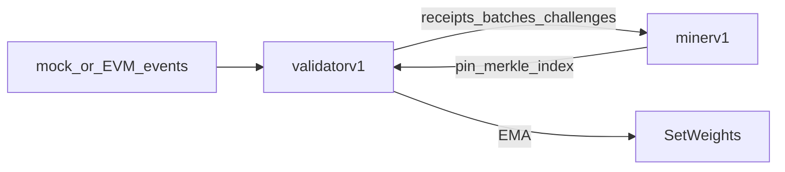

# Incentive mechanism test runbook (Part A)

How to verify MediLink’s receipt → challenge → EMA → weights path.

Related code:

- [`validatorv1.py`](../validatorv1.py) — `score_miner` / `score_miner_breakdown`, `run_challenge_round`, `maybe_set_weights`
- [`minerv1.py`](../minerv1.py) — `/receipt`, `/batch`, `/challenge/*`, `/index`
- [`configuration.md`](configuration.md) — scoring weights
- [`validator-miner-transport.md`](validator-miner-transport.md) — ThreadPoolExecutor + HTTP fanout deep-dive
- Part B (multi-grantee): [`multi-grantee-access-test.md`](multi-grantee-access-test.md)



---

## Automated tests (offline)

From `Main-Project/subnet-template`:

```bash
# Prefer the project venv that has bittensor installed:
../../bt_venv/bin/python -m unittest tests.test_incentive_scoring tests.test_incentive_smoke -v
```

| Module | Covers |
|---|---|
| `tests/test_incentive_scoring.py` | latency, integrity, consistency, composite `score_miner`, EMA, weight rate-limit |
| `tests/test_incentive_smoke.py` | in-process receipt → batch → pin/merkle/index → score ≥ 0.99 → EMA update |

No Subtensor, EVM, or HTTP axon required.

---

## A1. Live local smoke (mock events)

Requires registered wallets and a reachable network for metagraph sync (or a local chain).

1. Start miner:

```bash
cd Main-Project/subnet-template
python minerv1.py --axon.port 8091 --axon.ip <PUBLIC_OR_LOCAL_AS_NEEDED> \
  --wallet.name test-miner --wallet.hotkey default --netuid 573 --subtensor.network test
```

2. Health check: `curl -s http://127.0.0.1:8091/health`

3. Start validator with synthetic events and local axon override:

```bash
LOCAL_MINER_AXON=127.0.0.1:8091 \
python validatorv1.py --mock-events \
  --wallet test-validator --wallet-hotkey default --netuid 573 --network test
```

4. Confirm in logs / DB:

- Synthetic `CommitmentEvent` printed each loop
- Miner `miner_store_v1.db` gains receipt rows
- Challenge responses scored; `score_ema` updates
- `maybe_set_weights` either submits or waits for `WEIGHTS_RATE_LIMIT_BLOCKS` (100)

---

## A3. Live EVM incentive check

1. Point validator at AccessRegistry with `--no-mock-events` and `--access-registry <addr>`.
2. Emit `ResourceRegistered` + `AccessGranted` (see Part B / [`access-registry-live-test.md`](access-registry-live-test.md)).
3. Restart or set `--evm-start-block` just before those txs if the poller lagged.
4. Success: non-zero EMA for a miner uid; weight tx after ≥100 blocks (or clear rate-limit skip).

---

## Scoring reference (implemented)

| Dimension | Weight | Source |
|---|---|---|
| Availability | 0.40 | pin returns `receipt_json` |
| Latency | 0.25 | sigmoid vs 500ms / 5s |
| Integrity | 0.25 | sig 0.40 + CID 0.30 + merkle 0.30 |
| Consistency | 0.10 | tip match 0.6 + count drift ≤2 |

EMA: `α = 0.3`. Known gaps (full sig crypto verify, real IPFS, MMR) are documented in [`build-thought-process.md`](build-thought-process.md); tests assert current behavior.

**Bugfix while testing:** single-leaf Merkle proofs return an empty `proof_path`. Integrity scoring previously treated `[]` as missing and never awarded the merkle component; `validatorv1._integrity_score` now accepts an empty path when present and verifies leaf == root.
