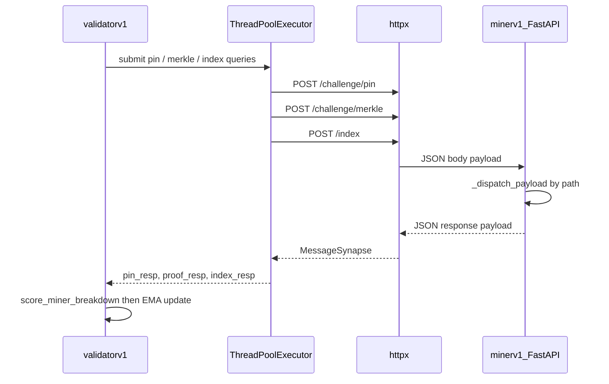

# Validator ↔ miner transport: ThreadPoolExecutor, dendrite fanout, and scoring

How MediLink v1 moves messages between [`validatorv1.py`](../validatorv1.py) and [`minerv1.py`](../minerv1.py), how `ThreadPoolExecutor` fits in, and how challenge responses become EMA scores.

Related code:

- Validator fanout: `_SynapseFanout` in `validatorv1.py`
- Miner HTTP axon: `setup_axon` / `_dispatch_payload` in `minerv1.py`
- Protocol envelope: `MessageSynapse` in [`protocol.py`](../protocol.py)

---

## Big picture

Bittensor v11 no longer ships Dendrite/Axon/Synapse for this path. MediLink replaces that with:

1. **Miner** — FastAPI HTTP server (`ServeAxon` publishes `ip:port` on the metagraph)
2. **Validator** — `_SynapseFanout` (still named `self.dendrite`) that `httpx.post`s JSON to those endpoints
3. **Envelope** — `MessageSynapse(payload={...})` wrapping a plain dict



---

## What `ThreadPoolExecutor` does

`concurrent.futures.ThreadPoolExecutor` is a **pool of OS threads** that run callables concurrently in the same process.

### Mental model

```python
with ThreadPoolExecutor(max_workers=3) as pool:
    future = pool.submit(fn, arg1, arg2)  # schedule fn(*args) on a worker thread
    result = future.result()              # block until that job finishes; return value or raise
```

- **`submit(fn, *args)`** — queues work; returns a `Future` immediately (does not wait).
- **`future.result(timeout=...)`** — waits for that job; returns `fn`'s return value.
- **`as_completed(futures)`** — yields futures as they finish (any order), useful for multi-axon fanout.
- **`max_workers`** — max threads running at once. Extra jobs wait in a queue.
- **`with` block** — shuts down the pool on exit (waits for pending jobs by default).

Important: this is **threading**, not asyncio. `httpx.post` is blocking I/O; threads let several HTTP calls overlap while waiting on the network. CPU-heavy work would not scale the same way (GIL), but these calls are network-bound.

### Where we use it

| Location | Workers | Purpose |
|---|---|---|
| `_SynapseFanout.query` | up to 8 | POST the **same** message to many miner axons in parallel |
| `run_challenge_round` | 3 | POST **pin + merkle + index** to **one** miner in parallel |

Without the pool, three challenge POSTs would run back-to-back (~sum of latencies). With the pool, wall time ≈ max(latency) of the three.

---

## How `self.dendrite.query` posts messages

`self.dendrite` is a `_SynapseFanout` instance (not legacy BT Dendrite).

### Step-by-step

1. **Caller builds a synapse**

```python
synapse = MessageSynapse(payload={"receipt_cid": "...", "nonce": "..."})
self.dendrite.query(axons=[axon], synapse=synapse, timeout=10.0)
```

2. **Path selection** — `_path_for_payload` inspects keys in `payload` and chooses the HTTP route:

| Payload shape | Path |
|---|---|
| `merkle_root` + `receipt_cids` | `/batch` |
| `target_receipt_cid` + `batch_cid` | `/challenge/merkle` |
| `receipt_cid` + `nonce` (no `op_type`) | `/challenge/pin` |
| mostly `actor_evm_addr` | `/index` |
| otherwise (receipt fields) | `/receipt` |

3. **URL per axon** — for each metagraph axon with a usable `ip:port`:

```text
http://{ip}:{port}{path}
```

Optional `LOCAL_MINER_AXON=127.0.0.1:8091` rewrites published miner endpoints for same-host smoke tests.

4. **Parallel HTTP** — each target is `pool.submit(self._post_one, url, body, timeout)` where body is:

```json
{ "payload": { ...synapse.payload... } }
```

5. **Collect responses** — results are stored in a list aligned with the input `axons` index. Missing/failed axons get `None`.

```python
out: List[Optional[MessageSynapse]] = [None] * len(axons)
# ... after workers finish ...
return out
```

So if you call `query(axons=[axon], ...)[0]`, you get that miner’s response (or `None` on failure).

### `_post_one` (single HTTP round-trip)

```text
validator                          miner
   |                                 |
   |  POST /challenge/pin              |
   |  {"payload": {...}}             |
   | -------------------------------->
   |                                 | FastAPI route → _dispatch_payload
   |  200 {"payload": {...}}         |
   | <--------------------------------
   |  wrap → MessageSynapse          |
```

Connect timeout is capped at 2s so dead public IPs fail fast; overall read timeout stays at `CHALLENGE_TIMEOUT_S` (10s).

---

## How miners know what to do with each message

The miner does **not** inspect a global “op type” from the validator beyond what’s in the JSON. Routing is by **URL path**.

### Axon setup

`minerv1.setup_axon()` starts uvicorn on `0.0.0.0:{axon_port}` and registers:

| Method | Path | Handler |
|---|---|---|
| GET | `/health` | liveness |
| POST | `/receipt` | `handle_receipt` |
| POST | `/batch` | `handle_batch_envelope` |
| POST | `/challenge/pin` | `handle_pin_challenge` |
| POST | `/challenge/merkle` | `handle_merkle_proof_challenge` |
| POST | `/index` | `handle_index_query` |

### Dispatch

```text
HTTP request
  → parse JSON body
  → payload = body["payload"]
  → _dispatch_payload(path, payload)
       → MessageSynapse(payload=payload)
       → handle_* (mutates / returns synapse with response fields)
  → HTTP 200 {"payload": <response dict>}
```

Examples of response fields:

- **Pin** — `receipt_json`, `miner_sig`, `retrieved_at_ns`
- **Merkle** — `proof_path`, `miner_sig`
- **Index** — `tip_cid`, `receipt_count`, `tip_batch_cid`, …

The miner “knows” the task because the validator chose `/challenge/pin` vs `/challenge/merkle` vs `/index` when building the URL.

---

## How the validator uses each miner’s response

### Challenge round (per miner uid)

```text
for each miner axon (skip self, skip port<=0):
  pick challenge target (actor tip receipt_cid, global batch_cid)
  in parallel:
    pin_resp   = dendrite.query([axon], pin_req)[0]
    proof_resp = dendrite.query([axon], proof_req)[0]
    index_resp = dendrite.query([axon], index_req)[0]
  breakdown = score_miner_breakdown(pin, proof, index, elapsed_ms)
  ema[uid] = α * raw + (1-α) * prev_ema
```

### Four scoring categories

| Dimension | Weight | What is checked |
|---|---|---|
| **Availability** | 0.40 | Pin returned non-empty `receipt_json` |
| **Latency** | 0.25 | Wall time for the parallel challenge trio (sigmoid vs 500ms / 5s) |
| **Integrity** | 0.25 | Sig present (0.40) + CID match (0.30) + merkle proof (0.30) inside this bucket |
| **Consistency** | 0.10 | Index `tip_cid` / `receipt_count` vs validator’s `actor_tips` |

```text
composite = 0.40*avail + 0.25*latency + 0.25*integrity + 0.10*consistency
ema ← 0.3*composite + 0.7*prev_ema
```

Logs look like:

```text
challenge uid=1 axon=127.0.0.1:8091 elapsed_ms=24 |
  avail=1.00 (w=0.400) latency=1.00 (w=0.250) integrity=1.00 (w=0.250)
  consistency=1.00 (w=0.100) | raw=1.0000 ema 0.9100→0.9370 (α=0.30)
```

(`w=` is the weighted contribution to the composite.)

### Broadcast paths (receipts / batches)

`broadcast_receipt` / `close_batch` call `dendrite.query(axons=self.metagraph.axons, ...)` so **all** published miners receive the same envelope in parallel. Individual responses are mostly ack/enrichment; scoring focuses on the later challenge round.

### Weights

EMA values feed `maybe_set_weights`, which submits `bt.SetWeights` at most once per **100 blocks** (on-chain rate limit). Challenges can stay frequent; weight commits stay sparse.

---

## End-to-end example (one challenge)

1. Validator loop builds a receipt from a mock/live EVM event and POSTs `/receipt` to miners.
2. After enough receipts or a time window, it POSTs `/batch` with a Merkle root.
3. Challenge round for uid 1:
   - Three threads POST pin / merkle / index to `http://127.0.0.1:8091/...`
   - Miner handlers read SQLite + in-memory Merkle cache and fill response payloads
   - Validator scores the three `MessageSynapse`s, logs the four-way breakdown, updates EMA
4. When 100 blocks have elapsed since `LastUpdate`, validator commits weights from EMA

---

## Failure modes (quick reference)

| Symptom | Meaning |
|---|---|
| `fanout failed … timed out` | TCP/HTTP never reached miner (firewall / wrong IP) |
| `pin_resp is None` | Availability → 0; composite collapses |
| Empty `proof_path` on multi-leaf batch | Integrity merkle component fails |
| High challenge score, weights skipped | Normal — waiting for 100-block rate limit |

For local same-host testing:

```bash
LOCAL_MINER_AXON=127.0.0.1:8091 python3 validatorv1.py --mock-events ...
```
